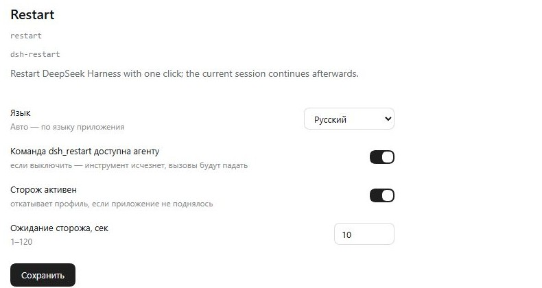

# dsh-restart

Restart DeepSeek Harness from the interface or with an agent tool — with the option to
continue the same session after the start.

## What it does

| Capability | Where |
|---|---|
| "Restart" button | sidebar footer, next to the account (power icon) |
| Confirmation | a modal with two buttons, no extra options |
| Agent tool | `dsh_restart({ fake })` — for extension development only |
| Session continuation | a restart via the tool opens the session and writes `[auto.continue]` |

## How the restart works

The restarting process cannot be a child of the application: `taskkill /T` kills the whole
tree together with it. So the plugin:

1. writes the marker `%LOCALAPPDATA%\dsh-restart\pending.json`;
2. creates a one-shot scheduler task `DSH-Restart` (Windows) with a helper script;
3. the helper waits 1.5 s, closes the application's process tree, waits 1.8 s, launches the
   `.exe` and deletes the task.

On macOS/Linux a separate `sh` process is used (`kill` + `open`/launch).

## Auto-continue

After the start the client reads the marker through the local bridge `127.0.0.1:49233`:

```
GET  /claim      → { marker } — atomic: only one client receives the marker
POST /restart    → write the marker and restart
GET  /health     → a live-host signal for the watchdog
GET  /settings   → current overrides
POST /settings   → save overrides (no restart)
```

Exactly one page load claims the marker, so double initialization does not produce two
messages. A restart via the tool returns the session with an `[auto.continue]` message: the
client opens the same session, waits for the composer to be ready, inserts the text and
sends it with the send button (Enter is the fallback). The sidebar footer button does not
create a marker and does not continue the session.

The user's draft is not lost: if the field already contains text, it is temporarily stashed
in `localStorage`, `[auto.continue]` is sent, and then the text is returned to the input
field (without being sent). The message queue is session state — the plugin neither reads
nor changes it.

## The tool

The tool exists for developing and debugging DSH itself: a plugin, `cordis.patch.yml`, the
profile. It is not intended for ordinary work, for "refreshing state", or for calls without
a code/config change that needs a fresh process.

```text
dsh_restart { fake: true }
→ Preflight passed; fake restart requested, nothing was restarted.
```

Without `fake` the tool restarts the application and returns the session with an
`[auto.continue]` message. The `fake` flag runs every check but restarts nothing — for
tests. If the tool is disabled, a call from old memory fails with
`unknown tool "dsh_restart"`.

## Plugin settings

On the Plugins → Restart → Configure page:

| Setting | Default | What it does |
|---|---|---|
| Language | Russian | language of the button and the form: Russian, English, Chinese, or "Auto" (follows the application language) |
| The `dsh_restart` command is available to the agent | enabled | when disabled the tool disappears; a call from old memory fails with `unknown tool "dsh_restart"` |
| Watchdog active | enabled | when disabled a restart just closes and opens the application, with no profile rollback |
| Watchdog wait, sec | 10 | how long to wait for a live-start signal before rolling back (1–120) |

Overrides are stored in `%LOCALAPPDATA%\dsh-restart\settings.json`; the values from
`cordis.patch.yml` remain the defaults. Saving settings needs no restart: the tool is
registered and unregistered on the fly, and the interface language is applied immediately.

## Languages

Interface languages: **Russian, English, Chinese**.

- The language comes from the extension setting `language` when it is `ru` / `en` / `zh`.
- `auto` follows the application language: `document.documentElement.lang` first, then
  `navigator.language`; `ru*` → `ru`, `zh*` → `zh`, otherwise `en`.
- The default is `ru`.
- It is changed in the settings form: Plugins → Restart → Configure.
- Overrides are stored in `%LOCALAPPDATA%\dsh-restart\settings.json`.

## When the tool refuses

`dsh_restart` is available to the agent only in "quiet" mode — when a restart will not
disturb anyone:

| Check | Refusal |
|---|---|
| Call from a subagent | `dsh_restart is only available to the main agent: a subagent cannot restart the app; do not retry, report the need to the parent agent instead` |
| Access mode is not Full access | `dsh_restart requires the Full access permission preset (current: …)` |
| Another session or subagent is still working | `dsh_restart refused: N other session(s) or subagent(s) are still working (…)` |
| A background job is still running | `dsh_restart refused: N background job(s) are still running (…)` |

The checks go through `ctx.permissionPresets.current(agent.session)`, `ctx.agents.list()`
and `ctx.jobs.list(agentId)`; a "working" status is `running` or a non-empty agent input
queue. A subagent is detected by `exec.agent.options.subagentDepth` (plus `exec.parent`).

The button in the interface performs none of these checks: the user decides when to restart.

## Limitations

- a **tray** item and an entry in the native **Application** menu cannot be added by the
  plugin: the tray and the menu live in the Electron main process, while the plugin lives
  in a child host process;
- the restart is performed through the Windows Task Scheduler; if policy forbids creating
  tasks, the restart will not work;
- workspace sessions that are executing a turn at that moment will be interrupted (as the
  modal warns).

### The button and the tool behave differently

- **`dsh_restart` (agent)** — always opens the session and writes `[auto.continue]`
  (or `[auto.continue.failed]` if the watchdog rolled the profile back).
- **The "Restart DeepSeek Harness" button in the sidebar** — simply restarts the
  application: no marker is created, the session is not continued, no auto-message is sent.

### Cookies and "Web authentication failed"

Every launch of Desktop Host takes a new port and sets a `dsh-auth-<random>` cookie for
`127.0.0.1`. Chromium stores cookies per host, not per port, so old cookies are not replaced
and accumulate. Measured on a live installation: about 122 such cookies produce a `Cookie`
header of roughly 17.5 KB, it stops fitting into the limit (16 KB), the welcome request
receives `431`, and the application fails with
`desktop welcome: Web authentication failed`. In addition, the lifetime of these cookies is
capped in the profile: `connection.cookieMaxAgeDays: 7`.

Before every launch (after the application is killed, before `Start-Process`) the helper
runs `src/cookie-clean.py` and deletes only the `dsh-auth-*` lines for
`127.0.0.1`/`localhost`. Other cookies are left alone.

If the application did crash on the welcome step (the crash log contains
`Web authentication failed`), the watchdog does not roll the profile back and does not
disable plugins: it cleans the cookies, launches the application once more and waits for a
healthy start.

### Binding the watchdog to a restart

Every restart gets a token:

```
dsh_restart → marker { token, sessionId } + watchdog.json { token }
watchdog  → compares the token in watchdog.json before rolling back
start     → the host deletes watchdog.json (the token is voided)
```

So the watchdog triggers only for the restart that started it, and cannot touch an
application raised later or by another restart.

Before rolling back, the watchdog compares the SHA-256 of `package.json`,
`cordis.patch.yml`, `cordis.yml` with the ones saved at request time. If the files were
changed by hand, no rollback is performed — the human is assumed to have taken over the
edits.

Profile files are written without a BOM (`WriteAllText` + `UTF8Encoding(false)`), otherwise
the host cannot read `package.json`.

### Known limitation: a subagent's job after its completion

If a subagent started a background job and finished its turn, DSH deletes the record of
that job together with the agent, although the job itself keeps running. The pre-restart
check **will not see** such a job and will not refuse the restart.

What is covered:

| Owner of the work | Refusal |
|---|---|
| Own background job | yes |
| A subagent or another session is still working | yes |
| Their jobs, while the owner is alive | yes |
| A subagent's job after its turn finished | no |

Why: the job registry `ctx.jobs` is keyed by agent id and is cleared when the agent is
destroyed; the `jobs.start` wrapper sees only jobs started through that path, while a
subagent starts them differently. Detection by child processes is unreliable: the
application's service processes constantly appear and disappear nearby. The solution is
deferred.

## Screenshots



## Installation

```bash
npx --yes github:machine202502/dsh-restart
```

Or manually:

```json
"dsh-restart": "github:machine202502/dsh-restart#main"
```

and add `dsh-restart` to `dsh.profile.bundles`.

After installation the application needs a restart (you can use the button once it appears).

## Verification

```bash
node tests/smoke.mjs                   # tool, checks, fake, bridge
node tests/load-client.mjs client.js   # the client module loads and returns apply
```

## License

MIT
