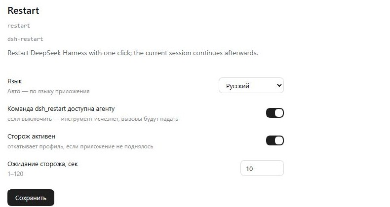

# dsh-restart

Перезапуск DeepSeek Harness из интерфейса или инструментом агента — с возможностью
продолжить ту же сессию после старта.

## Что делает

| Возможность | Где |
|---|---|
| Кнопка «Перезапустить» | футер сайдбара, рядом с аккаунтом (иконка питания) |
| Подтверждение | модалка с двумя кнопками, без лишних опций |
| Инструмент агента | `dsh_restart({ fake, reason, plugins })` — только для разработки расширений |
| Продолжение сессии | рестарт инструментом открывает сессию и пишет `[auto.continue.<token>]` |
| Окно сторожа | во время рестарта: фаза, таймер, причина, плагины, живой хвост журнала |
| Восстановление | откат профиля, карантин подозрительного плагина, безопасный режим |

## Как работает рестарт

Перезапускающий процесс не может быть потомком приложения: `taskkill /T` убивает всё
дерево вместе с ним. Поэтому плагин:

1. пишет маркер `%LOCALAPPDATA%\dsh-restart\pending.json`;
2. складывает снимок профиля для возможного восстановления (`prestart.json`,
   `pending-profile`);
3. создаёт одноразовую задачу планировщика `DSH-Restart` (Windows) или запускает
   отдельный `sh`-процесс (macOS/Linux);
4. helper показывает окно сторожа, закрывает дерево процесса приложения, раскладывает
   подготовленные файлы профиля, пока приложение остановлено, запускает его снова и
   удаляет задачу.

Запуск считается здоровым, только если рендерер отметился (`client-ready.json`) и нового
crash-лога не появилось. Тогда helper помечает текущий профиль как точку отката. Если
запуск нездоровый — возвращает `backup\last-good`, отправляет в карантин плагины с
изменённым рабочим деревом (их правки уходят в `git stash`) и запускает снова; если и это
не помогло, стартует только с базовыми бандлами и отмечает безопасный режим в
`safe-mode.json`.

Профиль никогда не правится под работающим приложением: `POST /profile/restore`
складывает файлы, а helper раскладывает их, пока приложение остановлено. Правка
`package.json` или `cordis.patch.yml` на живой сессии заставляет загрузчик переприменить
дерево плагинов и подвешивает окно.

## Автопродолжение

После старта клиент читает маркер через локальный мост `127.0.0.1:49233`:

```
GET  /claim           → { marker } — по одному клиенту за раз, признак выдачи в маркере
POST /claim/release   → вернуть маркер после неудачной попытки
POST /consumed        → погасить маркер после реальной отправки
POST /restart         → записать маркер и перезапустить
GET  /health          → признак живого хоста для сторожа
GET  /settings        → текущие переопределения
POST /settings        → сохранить переопределения (без перезапуска)
```

Текст продолжения несёт токен рестарта: `[auto.continue.<token>]` или
`[auto.continue.failed.<token>]` после невосстановленного запуска. Токен тот же, что в
`pending.json` и `overlay.json`, поэтому дубль или потерянное сообщение в чате однозначно
привязываются к своему рестарту. Маркер выдаётся только одному клиенту — lock на 15 секунд
плюс постоянное поле `deliveredAt` — а одна попытка отправляет максимум один раз: клиент
нажимает кнопку отправки, ждёт очистки поля и никогда не смешивает кнопку с Enter.

Рестарт инструментом возвращает сессию этим сообщением: клиент открывает ту же сессию,
дожидается готовности композера, вставляет текст и отправляет его. Кнопка в футере
сайдбара маркер не создаёт и сессию не продолжает.

Черновик пользователя не теряется: если в поле уже есть текст, он временно
откладывается в `localStorage`, отправляется маркер, после чего текст возвращается в поле
ввода (без отправки). Очередь сообщений — состояние сессии, плагин её не читает и не
меняет.

## Инструмент

Инструмент нужен для разработки и отладки самого DSH: плагин, `cordis.patch.yml`, профиль.
Он не предназначен для обычной работы, «обновления состояния» или вызовов без изменения
кода/конфигурации, которое требует свежего процесса.

```text
dsh_restart { fake: true }
→ Preflight passed; fake restart requested, nothing was restarted.
```

Без `fake` инструмент перезапускает приложение и возвращает сессию сообщением
`[auto.continue]`. Флаг `fake` прогоняет все проверки, но ничего не перезапускает —
для тестов. Если инструмент отключён, вызов из старой памяти падает с
`unknown tool "dsh_restart"`.

## Настройки плагина

На странице Plugins → Restart → Configure:

| Настройка | По умолчанию | Что делает |
|---|---|---|
| Язык | Русский | язык кнопки и формы: русский, английский, китайский или «Авто» (по языку приложения) |
| Команда `dsh_restart` доступна агенту | включено | при выключении инструмент исчезает; вызов из старой памяти падает с `unknown tool "dsh_restart"` |
| Сторож активен | включено | при выключении рестарт просто закрывает и открывает приложение, без отката профиля |
| Ожидание сторожа, сек | 10 | сколько ждать признака живого старта перед откатом (1–120) |

Переопределения хранятся в `%LOCALAPPDATA%\dsh-restart\settings.json`; значения из
`cordis.patch.yml` остаются умолчаниями. Сохранение настроек не требует перезапуска:
инструмент регистрируется и снимается на лету, а язык интерфейса применяется сразу.

## Языки

Языки интерфейса: **русский, английский, китайский**.

- Язык берётся из настройки расширения `language`, если там `ru` / `en` / `zh`.
- `auto` — по языку приложения: сначала `document.documentElement.lang`, затем
  `navigator.language`; `ru*` → `ru`, `zh*` → `zh`, иначе `en`.
- По умолчанию — `ru`.
- Меняется в форме настроек: Plugins → Restart → Configure.
- Переопределения хранятся в `%LOCALAPPDATA%\dsh-restart\settings.json`.

## Когда инструмент отказывает

`dsh_restart` доступен агенту только в «тихом» режиме — когда перезапуск никому не помешает:

| Проверка | Отказ |
|---|---|
| Вызов из подагента | `dsh_restart is only available to the main agent: a subagent cannot restart the app; do not retry, report the need to the parent agent instead` |
| Режим доступа не Full access | `dsh_restart requires the Full access permission preset (current: …)` |
| Другая сессия или подагент ещё работает | `dsh_restart refused: N other session(s) or subagent(s) are still working (…)` |
| Есть работающая фоновая задача | `dsh_restart refused: N background job(s) are still running (…)` |

Проверки идут через `ctx.permissionPresets.current(agent.session)`, `ctx.agents.list()`
и `ctx.jobs.list(agentId)`; статус «работает» — `running` либо непустая очередь входа агента.
Признак подагента — `exec.agent.options.subagentDepth` (плюс `exec.parent`).

Кнопка в интерфейсе эти проверки не выполняет: пользователь сам решает, когда перезапускать.

## Ограничения

- пункт в **трее** и в нативном меню **Application** плагином добавить нельзя:
  трей и меню живут в процессе Electron main, а плагин — в дочернем host-процессе;
- перезапуск выполняется через Планировщик задач Windows; если политика запрещает
  создание задач, рестарт не сработает;
- воркспейс-сессии, которые в этот момент выполняют ход, будут прерваны (как и
  предупреждает модалка);
- helper для macOS/Linux (`src/helper.sh`) повторяет виндовую цепочку и проходит `sh -n`,
  но на живой POSIX-машине ещё не запускался;
- окну на Tk нужен Python с tkinter и графическая сессия; без них используется окно на
  PowerShell (Windows) или хвост журнала в консоли.

### Кнопка и инструмент ведут себя по-разному

- **`dsh_restart` (агент)** — всегда открывает сессию и пишет `[auto.continue.<token>]`
  (или `[auto.continue.failed.<token>]`, если запуск не восстановлен).
- **Кнопка «Restart DeepSeek Harness» в сайдбаре** — просто перезапускает приложение:
  маркер не создаётся, сессия не продолжается, авто-сообщение не отправляется.

### Куки и «Web authentication failed»

Каждый запуск Desktop Host занимает новый порт и ставит куку `dsh-auth-<random>`
для `127.0.0.1`. Chromium хранит куки по хосту, а не по порту, поэтому старые куки
не заменяются и копятся. Замерено на живой установке: около 122 таких куки дают
заголовок `Cookie` примерно на 17.5 КБ, он перестаёт влезать в лимит (16 КБ),
приветственный запрос получает `431`, и приложение падает с
`desktop welcome: Web authentication failed`. Дополнительно срок жизни этих куки
ограничен в профиле: `connection.cookieMaxAgeDays: 7`.

Перед каждым запуском (после убийства приложения, до `Start-Process`) helper
запускает `src/cookie-clean.py` и удаляет только строки `dsh-auth-*` для
`127.0.0.1`/`localhost`. Остальные куки не трогаются.

Если приложение всё же упало именно на приветствии (лог падения содержит
`Web authentication failed`), сторож не откатывает профиль и не отключает
плагины: он чистит куки, запускает приложение ещё раз и ждёт здорового старта.

### Как сторож принимает решение

Каждый рестарт получает токен. Он лежит в маркере и `prestart.json`, показывается в окне
(причина и плагины) и стоит в конце текста продолжения.

```
старт      → запуск здоров, если свежий client-ready.json и нет нового crash-лога
здоров     → текущий профиль помечается как точка отката (backup\last-good)
не здоров  → вернуть last-good, в карантин плагины с изменённым git-деревом (правки в стеш)
всё ещё нет → безопасный режим: только базовые бандлы, список отключённого в safe-mode.json
```

Восстановленный запуск продолжает сессию как обычно; `[auto.continue.failed.<token>]`
уходит только из безопасного режима. Файлы профиля пишутся без BOM
(`UTF8Encoding(false)`), иначе хост не может прочитать `package.json`.

### Окно

Окно необязательно: само восстановление написано на чистом Node. Три уровня, выбор при
старте:

| Условие | Окно |
|---|---|
| Python с tkinter и дисплей | окно на Tk (`src/overlay.py`), ru/en/zh |
| tkinter нет, Windows | тонкое окно на PowerShell (`src/overlay.ps1`), ru/en/zh |
| графики нет вообще (например Linux без дисплея) | `tail -f` журнала `restart.log` |

Журнал занимает всю оставшуюся высоту, окно растягивается, оба движка стартуют с
`640×420`, и вид держится в конце, пока пользователь сам не уведёт скролл.

### Известное ограничение: задача подагента после его завершения

Если подагент запустил фоновую задачу и завершил ход, DSH удаляет запись об этой
задаче вместе с агентом, хотя сама задача продолжает работать. Проверка перед
рестартом такую задачу **не увидит** и рестарт не отклонит.

Что покрыто:

| Владелец работы | Отказ |
|---|---|
| Своя фоновая задача | да |
| Подагент или чужая сессия ещё работают | да |
| Их задачи, пока владелец жив | да |
| Задача подагента после завершения его хода | нет |

Почему так: реестр задач `ctx.jobs` ключуется по id агента и очищается при его
уничтожении; обёртка `jobs.start` видит только задачи, запущенные через этот путь, а
подагент запускает их иначе. Детект по дочерним процессам ненадёжен: рядом постоянно
появляются и исчезают служебные процессы приложения. Решение отложено.

## Скриншоты



## Установка

```bash
npx --yes github:machine202502/dsh-restart
```

Или вручную:

```json
"dsh-restart": "github:machine202502/dsh-restart#main"
```

и добавить `dsh-restart` в `dsh.profile.bundles`.

После установки нужен перезапуск приложения (можно кнопкой, когда она появится).

## Проверка

```bash
node tests/smoke.mjs                   # инструмент, проверки, fake, мост
node tests/load-client.mjs client.js   # клиентский модуль грузится и отдаёт apply
```

## Лицензия

MIT
